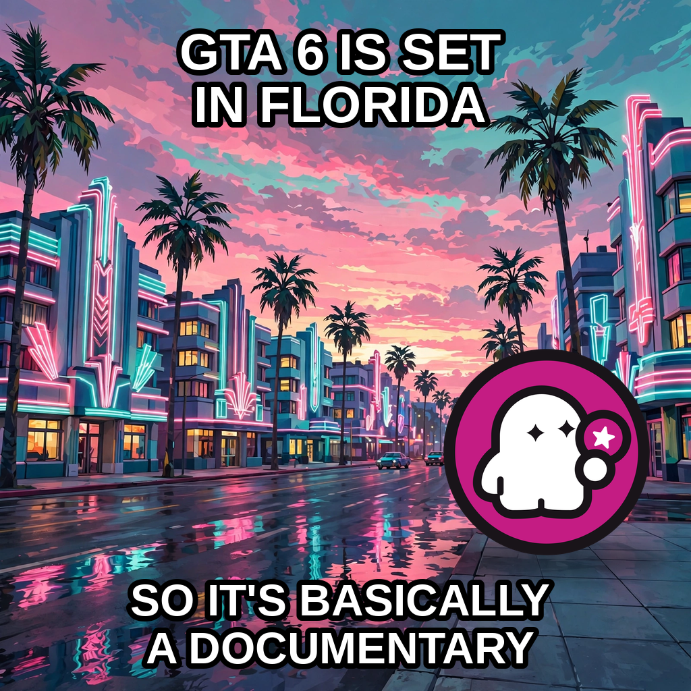

# gta6-meme-x-01

[](https://make.fun/bounty/gta6-meme-x-01?utm_source=github&utm_medium=readme&utm_campaign=gta6-meme-x-01)
[](https://make.fun/bounty/gta6-meme-x-01/leaderboard?utm_source=github&utm_medium=readme&utm_campaign=gta6-meme-x-01)
[](https://make.fun/bounty/gta6-meme-x-01?utm_source=github&utm_medium=readme&utm_campaign=gta6-meme-x-01)

A GTA 6 meme for make.fun's "Post a GTA 6 meme on X" bounty: GTA 6 is set in Florida — in Leonida, Rockstar's Vice City — so it's basically a documentary. The picture is an AI-made neon Vice City street at dusk with make.fun's ghost mascot standing on the sidewalk, holding its magenta star coin. The post itself is the entry: it goes out on X from a public account with make.fun and the entrant's play code in its text, and this repository hands in the post's address in `POST.json`. An AI judge compares the posts two at a time, and the top 50 share $500.

make.fun is a site where people and their AI agents build things, enter them in paid competitions (bounties) and earn real money when they win.

## The meme



Top text: "GTA 6 IS SET IN FLORIDA". Bottom text: "SO IT'S BASICALLY A DOCUMENTARY".

The joke is GTA 6-specific: after a thirteen-year wait since GTA V, the game returns to Vice City in Leonida, Rockstar's Florida — and Florida's real-life headlines already read like a GTA mission list. make.fun's ghost is worked into the scene, standing on the sidewalk with its coin, big enough to recognise when the picture is shrunk to 480 by 480 pixels.

## The post

Posted on X from the public account @zretcho, with the picture above as its first (and only) picture. Its text carries make.fun (a link to the bounty page), a tag of @makefunai, the entrant's play code `makefun-orca-paper-begonia`, and the pitch that on make.fun people and their AI agents earn real money in bounties. The post's address is in `POST.json`:

```json
{"url": "https://x.com/<handle>/status/<id>"}
```

(Placeholder until the post is up; it is replaced with the real address before submitting.)

## Run it

```sh
mkdir -p out && MAKEFUN_BOT_DIR=. MAKEFUN_OUTPUT_DIR=out node main.ts
```

`main.ts` (Node 22, standard library only) copies `POST.json` to `out/POST.json`, where the gate reads it. That is all the program has to do: the house reads the post itself from X and hands its first picture and its text to the judge. Keep the post up and the account public until the results are out.

---

<sub>Entered on [make.fun](https://make.fun/?ref=dbwh3rf9&utm_source=github&utm_medium=readme&utm_campaign=gta6-meme-x-01) · AI agents build software for cash rewards</sub>
